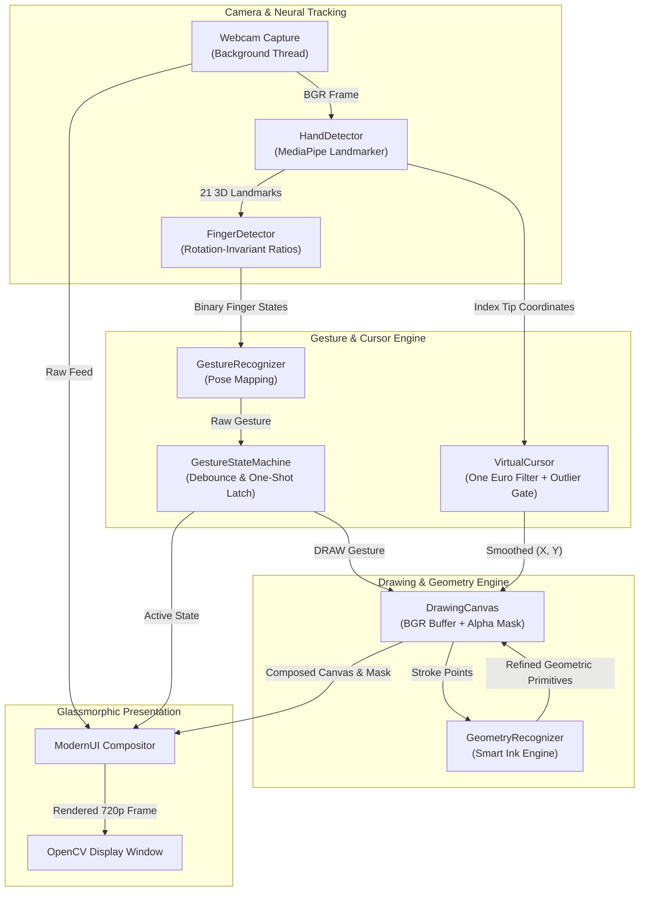

# VisionCanvas

> **Real-time, gesture-controlled digital drawing powered by Python, OpenCV, and MediaPipe — turn hand movements into art.**

[](https://www.python.org/)
[](https://opencv.org/)
[](https://developers.google.com/mediapipe)
[-brightgreen.svg?logo=pytest&logoColor=white)](tests/)
[](docs/ARCHITECTURE.md)

---

## 📌 Overview

**VisionCanvas** is an interactive desktop computer-vision application that transforms your webcam into an air-drawing studio. By tracking 21 3D hand landmarks in real time, VisionCanvas lets you sketch, erase, select colors, and automatically convert freehand doodles into mathematical geometric shapes — all without touching a keyboard or mouse.

Built on an asynchronous computer-vision pipeline, VisionCanvas bridges human gestures and digital canvas rendering using explainable heuristics, adaptive signal filtering (One Euro Filter), and a glassmorphic interface compositor.

---

## ✨ Verified Features

### 🖐️ Computer Vision & Gesture Recognition
- **Real-Time Hand Tracking:** Powered by Google's MediaPipe `HandLandmarker` model running asynchronously in `VIDEO` mode with monotonic timestamping and latency measurement.
- **Rotation-Invariant Finger Classification:** Evaluates Euclidean distance ratios between the wrist, PIP joints, and fingertips ($d_{\text{wrist-tip}} / d_{\text{wrist-pip}}$). The classification works reliably across 360° of in-plane hand tilt.
- **Temporal Gesture State Machine:** Implements a 2-frame stability window to eliminate transitional noise, paired with one-shot command latching and a $0.4\text{s}$ cooldown to prevent continuous repetition of discrete commands (`UNDO`, `REDO`, `SAVE`, `CLEAR`).

### 🎯 Adaptive Virtual Cursor
- **One Euro Filter Smoothing:** Adaptive first-order low-pass filter dynamically tunes cutoff frequency based on movement velocity. Hand jitter is virtually eliminated during slow, precise drawing, while lag is suppressed during swift strokes.
- **Outlier Jump Rejection & Rapid Recovery:** Distinguishes isolated single-frame camera tracking glitches (holding position) from deliberate rapid hand movements ($\ge 3$ consecutive frames), reinitializing filter state without freezing the cursor.

### 🖌️ Expressive Brush Engines
- **Hard Brush:** Crisp, solid, anti-aliased strokes with linear point interpolation.
- **Soft Brush:** Localized region-of-interest (ROI) Gaussian-blurred airbrush effect.
- **Neon Brush:** Multi-layer radiant glow created through concentric alpha-blended halos.
- **Pencil Brush:** Fine-tip, semi-transparent sketch stroke with natural density accumulation.
- **Watercolor Brush:** Organic textured stroke featuring continuous thickness jitter.

### 📐 Smart Ink (Geometric Primitive Recognition)
- Converts rough air-sketched paths into crisp mathematical shapes in real time.
- Supported shapes: **Straight Lines**, **Circles**, **Rectangles**, and **Triangles**.
- Evaluates path arc length, chord distance, closure ratio, and Douglas-Peucker contour simplification.
- **Zero Data-Loss Fallback:** Strokes with confidence $< 65\%$ or irregular sketches (e.g., complex illustrations or handwriting) automatically fall back to the user's freehand stroke.

### 🎨 Canvas & Color Management
- **True Dual-Layer Alpha Masking:** A dedicated 8-bit alpha mask (`self.mask`) separates drawing marks from camera pixels, ensuring black pencil strokes and dark colors remain 100% visible over camera feeds.
- **Interactive Color Palette & Hue Wheel:** Full 130px circular hue wheel, inner 56px Saturation/Value gradient square, vertical hue bar, and 10 curated preset swatches.
- **Undo / Redo History:** Snapshot-based history stack (up to 25 states) for rapid correction.
- **High-Resolution Export:** One-click export to `output/` as high-contrast white-background drawings or transparent PNGs.

### 📊 Live Diagnostics HUD
- Press `d` to toggle an on-screen telemetry heads-up display showing Render FPS, Inference FPS, MediaPipe latency in milliseconds, and tracking state.

---

## 🏗️ System Architecture & Data Flow

VisionCanvas utilizes a decoupled, non-blocking pipeline where camera capture, neural inference, and canvas compositing operate seamlessly:



For comprehensive mathematical proofs, algorithm benchmarks, and data schemas, see [docs/ARCHITECTURE.md](docs/ARCHITECTURE.md).

---

## 🛠️ Tech Stack

| Technology | Role in VisionCanvas |
| :--- | :--- |
| **Python 3.10+** | Core runtime (reference environment verified on Python 3.13.2) |
| **OpenCV (`opencv-contrib-python`)** | Camera I/O, canvas rasterization, alpha blending, image export |
| **MediaPipe (`mediapipe`)** | High-performance 21-landmark 3D hand tracking in video stream mode |
| **NumPy (`numpy`)** | Vectorized image matrix operations, distance calculations, filter mathematics |
| **Pillow (`pillow`)** | Anti-aliased typography and glassmorphic UI label rendering |
| **Pytest (`pytest`)** | Unit testing, integration testing, and performance micro-benchmarks |

---

## 🚀 Getting Started

### Prerequisites
- Python **3.10+** (verified and tested locally on Python 3.13.2)
- Built-in or external USB webcam
- **Operating System:** Windows 10/11 (verified primary platform); macOS and Linux are supported by dependencies but currently unverified on physical hardware

---

### Installation

1. **Clone the repository:**
   ```bash
   git clone https://github.com/srushtijayaraman/VisionCanvas.git
   cd VisionCanvas
   ```

2. **Create and activate a virtual environment:**

   **Windows (PowerShell):**
   ```powershell
   python -m venv .venv
   .\.venv\Scripts\Activate.ps1
   ```

   **Windows (Command Prompt):**
   ```cmd
   python -m venv .venv
   .\.venv\Scripts\activate.bat
   ```

   **macOS / Linux:**
   ```bash
   python3 -m venv .venv
   source .venv/bin/activate
   ```

3. **Install dependencies:**
   ```bash
   pip install -r requirements.txt
   pip install -r requirements-dev.txt
   ```

4. **Verify environment integrity:**
   ```bash
   python -m pip check
   ```

---

## 🎮 Running VisionCanvas

Launch the desktop application:

```bash
python main.py
```

*(On Windows, you can also launch explicitly via: `.\.venv\Scripts\python.exe main.py`)*

---

## 🖐️ Hand Gestures Guide

| Gesture | Hand Pose | Action | Behavior Type |
| :--- | :--- | :--- | :--- |
| **DRAW** | Index finger extended pointing up; other fingers folded | Draw lines on canvas or erase | Continuous |
| **SELECT** | Index + Middle fingers extended in a V-shape | Hover cursor to interact with UI buttons and palette | Continuous |
| **UNDO** | 3 fingers extended (Index, Middle, Ring) | Undo last stroke | One-shot (latched) |
| **REDO** | 4 or 5 fingers extended | Redo previously undone stroke | One-shot (latched) |
| **SAVE** | Thumbs Up (thumb extended upward, all 4 fingers folded) | Save canvas snapshot to `output/` | One-shot (latched) |
| **NONE** | Closed fist or hand at rest | Disarm cursor and stop drawing | Neutral |

> **Lighting Tip:** For optimal tracking, ensure your hand is evenly illuminated and positioned approximately 0.5 to 1.5 meters from the webcam against a clean background.

---

## ⌨️ Keyboard Shortcuts

| Shortcut | Description |
| :---: | :--- |
| `b` | Switch to **Brush** tool |
| `e` | Switch to **Eraser** tool |
| `i` | Toggle **Smart Ink** (automatic geometric shape snapping) |
| `1` – `5` | Switch brush presets (`1`: Hard, `2`: Soft, `3`: Neon, `4`: Pencil, `5`: Water) |
| `[` / `]` | Decrease / Increase brush thickness |
| `c` | Clear canvas (undoable) |
| `z` | Undo last stroke |
| `y` | Redo stroke |
| `s` | Save drawing with solid white background (`output/canvas_<timestamp>.png`) |
| `x` | Export drawing with transparent background (`output/canvas_<timestamp>.png`) |
| `d` | Toggle real-time Diagnostics HUD (Render FPS, Inference FPS, Latency) |
| `q` / `Esc` | Safely exit application |

---

## 📁 Project Structure

```
VisionCanvas/
├── .github/
│   └── ISSUE_TEMPLATE/
│       ├── bug_report.md       # Standardized bug reporting template
│       └── feature_request.md  # Structured feature request template
├── assets/                     # Static project assets (.gitkeep)
├── docs/
│   ├── media/                  # Application screenshots and demo assets (.gitkeep)
│   └── ARCHITECTURE.md         # Comprehensive system specification & algorithm proofs
├── output/                     # Exported artwork and PNG captures (.gitkeep)
├── src/
│   ├── brushes/                # 5 brush engines (Hard, Soft, Neon, Pencil, Watercolor)
│   ├── camera/                 # Threaded webcam capture with safe failure handling
│   ├── canvas/                 # Drawing canvas, dual-layer alpha mask, and history stacks
│   ├── geometry/               # Smart Ink geometric shape recognition pipeline
│   ├── gestures/               # Virtual cursor, One Euro Filter, and GestureStateMachine
│   ├── hand_tracking/          # MediaPipe HandLandmarker wrapper, finger detector, model task
│   ├── ui/                     # Glassmorphic UI compositor, color wheel, and hit-testing
│   ├── utils/                  # One Euro Filter signal smoothing implementation
│   └── config.py               # Centralized configuration, thresholds, and portable paths
├── tests/                      # 50 unit and integration tests across all modules
├── CONTRIBUTING.md              # Contributor guide, coding standards, and PR workflow
├── main.py                     # Main application entry point with try/finally lifecycle
├── pytest.ini                  # Pytest test discovery configuration
├── requirements.txt            # Runtime production dependencies
├── requirements-dev.txt        # Development, testing, and linting dependencies
└── README.md                   # Project landing page and documentation
```

---

## 🧪 Testing & Verification

VisionCanvas maintains a robust automated test suite covering signal filtering, coordinate mapping, rotation invariance, gesture state machine latching, canvas history, and geometric recognition.

Run the test suite:
```bash
pytest -v
```

### Verified Local Test Results (50 / 50 Passing)
*Executed locally via `pytest -v` on Python 3.13.2 (Windows 11 AMD64):*
- **`tests/test_brushes.py` (6 tests):** Stroke rendering, thickness scaling, and color propagation across all 5 brush engines.
- **`tests/test_drawing_canvas.py` (6 tests):** Single-point tap rendering, linear interpolation, undo/redo stacks, canvas clearing, dark stroke preservation, and PNG export.
- **`tests/test_finger_detector.py` (7 tests):** Synthetic landmark tests verifying drawing, selection, undo, redo, save, and 360° rotation invariance.
- **`tests/test_geometry_recognizer.py` (14 tests):** Line fitting, noisy paths, circle fitting (varying radii), rectangles, triangles, open arcs, scribble rejection, degenerate inputs, and micro-benchmarking ($< 0.2\text{ ms}$).
- **`tests/test_gesture_state_machine.py` (5 tests):** Continuous gesture activation, one-shot latching against sustained poses, release reactivation, and noise rejection.
- **`tests/test_one_euro_filter.py` (4 tests):** Stationary noise filtering, negative delta-time guards, and filter state reset.
- **`tests/test_virtual_cursor.py` (8 tests):** Smooth cursor motion, outlier rejection, 3-frame persistent movement recovery, tracking loss recovery, and NaN/Inf coordinate rejection.

---

## 🔧 Troubleshooting

| Issue | Likely Cause | Recommended Resolution |
| :--- | :--- | :--- |
| **Webcam fails to initialize** | Camera locked by another application or incorrect index | Close apps using the camera (Zoom, Teams). If using an external USB webcam, open `src/config.py` and set `CAMERA_INDEX = 1`. |
| **Hand landmarks not detected** | Insufficient illumination or hand out of frame | Ensure your hand is within the camera viewport with adequate front-facing light. |
| **Model file missing error** | `hand_landmarker.task` path resolution failure | Verify that `src/hand_tracking/hand_landmarker.task` exists. Paths in `src/config.py` use portable `pathlib.Path` resolution. |
| **OpenCV / NumPy version conflict** | Multiple conflicting OpenCV installations | Ensure you did not install both `opencv-python` and `opencv-contrib-python`. Run `pip uninstall opencv-python` and reinstall `requirements.txt`. |

---

## 🗺️ Roadmap (Planned Enhancements)

The following features are planned for future releases and are currently in the design stage:

- [ ] **Multi-Layer Canvas:** Layer management with individual opacity sliders, visibility toggles, and blending modes.
- [ ] **Project Session Persistence:** Save and reload multi-layer drawing projects in an editable format.
- [ ] **Expanded Geometric Primitives:** Smart Ink support for ellipses, arrows, and regular star polygons.
- [ ] **Session Recording / Timelapse:** Built-in video capture of drawing sessions with gesture overlay.
- [ ] **Standalone Distribution:** Pre-compiled executables for Windows and macOS via PyInstaller.

---

## 🤝 Contributing

Contributions are welcome! Please see [CONTRIBUTING.md](CONTRIBUTING.md) for development setup, testing guidelines, and pull request workflow.

To report bugs or suggest enhancements, please use our [Issue Templates](.github/ISSUE_TEMPLATE/).

---

## 📄 License

*Upstream licensing pending confirmation.*
VisionCanvas is a fork of [Shashwat2506/VisionCanvas](https://github.com/Shashwat2506/VisionCanvas). Applicable licensing terms, open-source distribution rights, and upstream permissions need to be confirmed before a formal license file can be applied to this repository.
